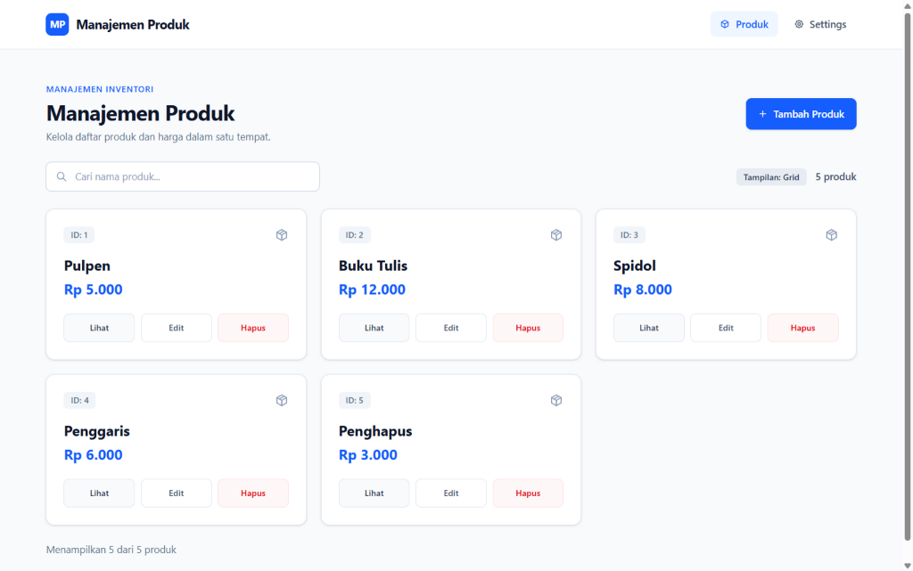
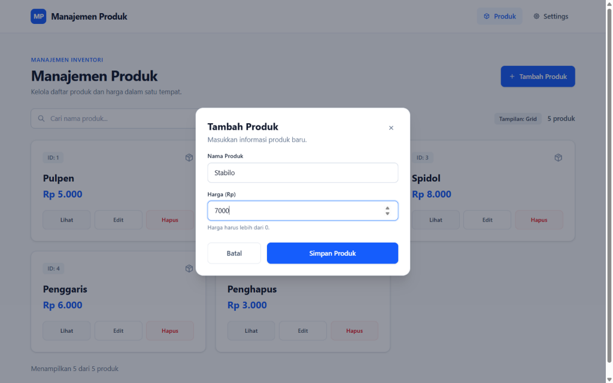
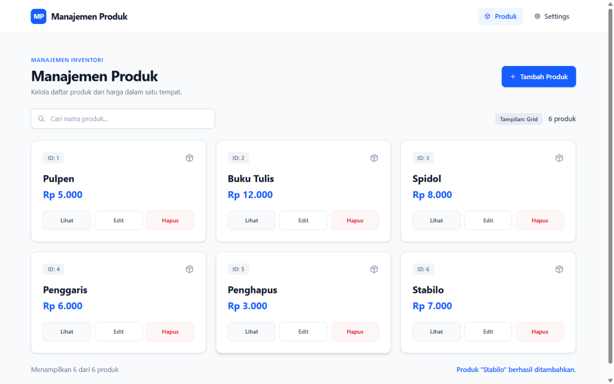
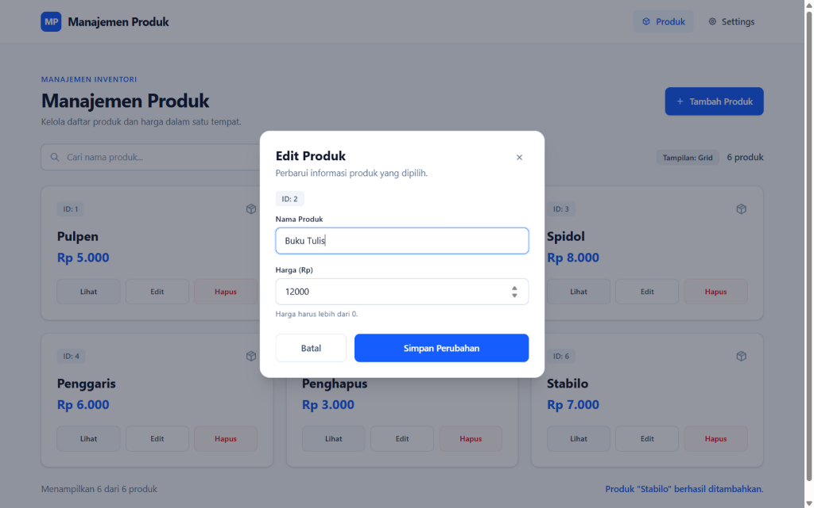
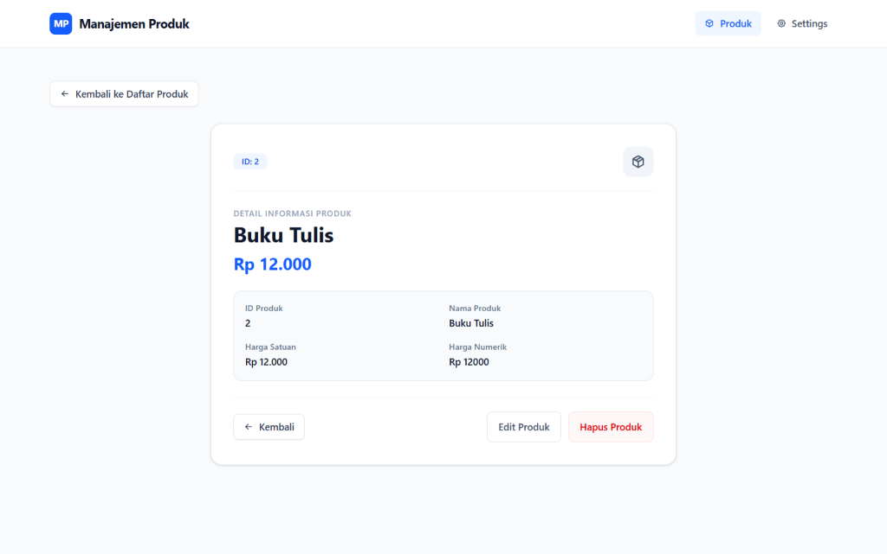
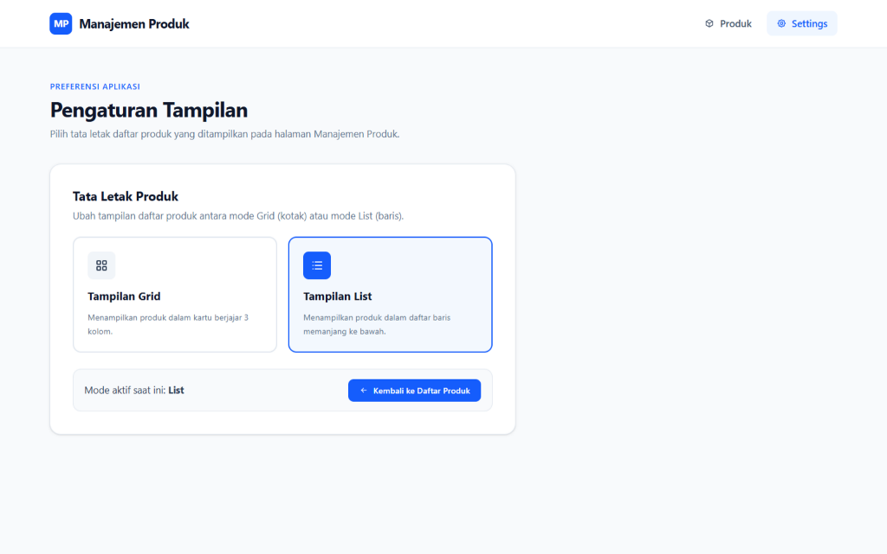
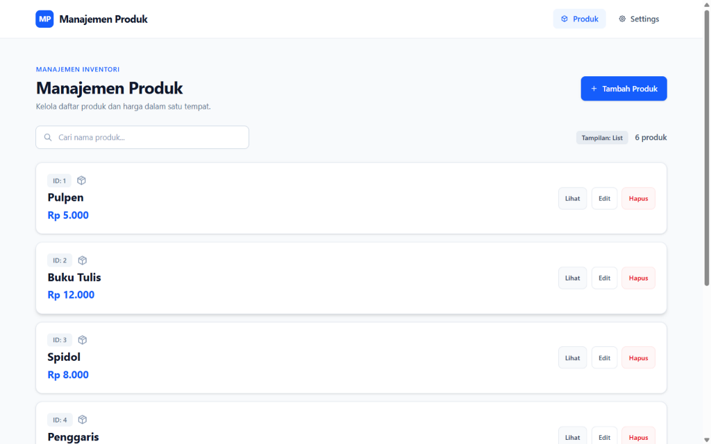
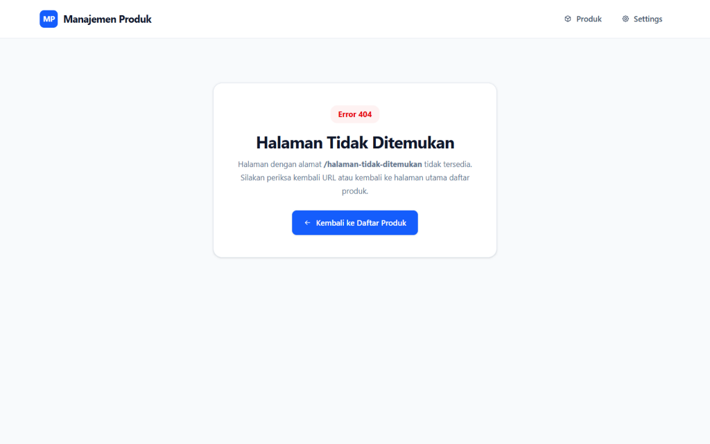

# Manajemen Produk — Tugas Pemrograman Web (React, TypeScript, React Router & Tailwind CSS)

Aplikasi web **Manajemen Produk** berbasis [anasmcfudy/react-template](https://github.com/anasmcfudy/react-template) menggunakan **React 19, TypeScript, Vite, React Router v7, Tailwind CSS v4, dan Atomic Design**.

## Fitur & Halaman

1. **Halaman Daftar Produk (`/products`)**
   - Menampilkan daftar produk awal (`Pulpen`, `Buku Tulis`, `Spidol`, `Penggaris`, `Penghapus`).
   - Mendukung operasi CRUD lengkap: **Tambah Produk**, **Lihat Detail**, **Edit Produk**, dan **Hapus Produk** menggunakan modal *pop-up*.
   - Pencarian produk secara *real-time* berdasarkan nama produk.
   - Mendukung perubahan tata letak tampilan **Grid** (3 kolom) maupun **List** (baris memanjang) sesuai pengaturan pada halaman Settings.
2. **Halaman Detail Produk (`/products/:id`)**
   - Menampilkan detail informasi produk sesuai parameter `:id` pada URL.
   - Dilengkapi tombol tautan (`Link`) **Kembali ke Daftar Produk** (`/products`) serta aksi **Edit Produk** dan **Hapus Produk**.
   - Menampilkan pesan jelas apabila ID produk tidak ditemukan.
3. **Halaman Pengaturan Tampilan (`/settings`)**
   - Mengubah mode tampilan daftar produk antara **Tampilan Grid** dan **Tampilan List** yang tersimpan pada *shared state* (`ProductProvider`).
4. **Halaman 404 (`*`)**
   - Menampilkan pesan kesalahan **Error 404 — Halaman Tidak Ditemukan** secara jelas beserta tautan (`Link`) kembali ke `/products`.

## Perintah Menjalankan Proyek

```bash
npm install
npm run dev
npm run typecheck
npm run lint
npm test
npm run build
```

## Bukti Pengujian

| Skenario | Hasil yang Diharapkan | Hasil Aktual |
|---|---|---|
| Membuka halaman `/products` | Daftar 5 produk awal ditampilkan beserta pencarian dan tombol aksi CRUD | Sesuai |
| Menambah, mengedit, dan menghapus produk pada `/products` | Modal *pop-up* tampil dan perubahan data produk langsung tersimpan | Sesuai |
| Membuka halaman detail `/products/:id` (contoh: `/products/2`) | Detail produk sesuai ID (`Buku Tulis` - `Rp 12.000`) dan tautan kembali ke `/products` ditampilkan | Sesuai |
| Mengubah mode tampilan dari halaman `/settings` ke **Tampilan List** | Tata letak daftar produk pada `/products` berubah dari Grid menjadi List | Sesuai |
| Membuka URL yang tidak dikenal (contoh: `/halaman-tidak-ditemukan`) | Halaman 404 tampil dengan pesan jelas dan tautan kembali ke `/products` | Sesuai |

### Lampiran Screenshot Pengujian
1. **Halaman Utama Daftar Produk (Mode Grid)**
   
2. **Pop-up Tambah Produk & Hasil Penambahan**
   
   
3. **Pop-up Edit Produk**
   
4. **Halaman Detail Produk (`/products/2`)**
   
5. **Halaman Settings (`/settings` — Pilihan Grid / List)**
   
6. **Halaman Daftar Produk dalam Mode List**
   
7. **Halaman 404 Tidak Ditemukan**
   
