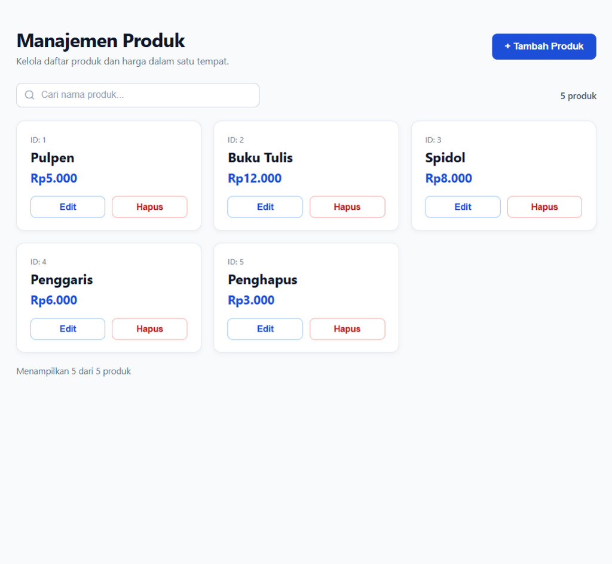
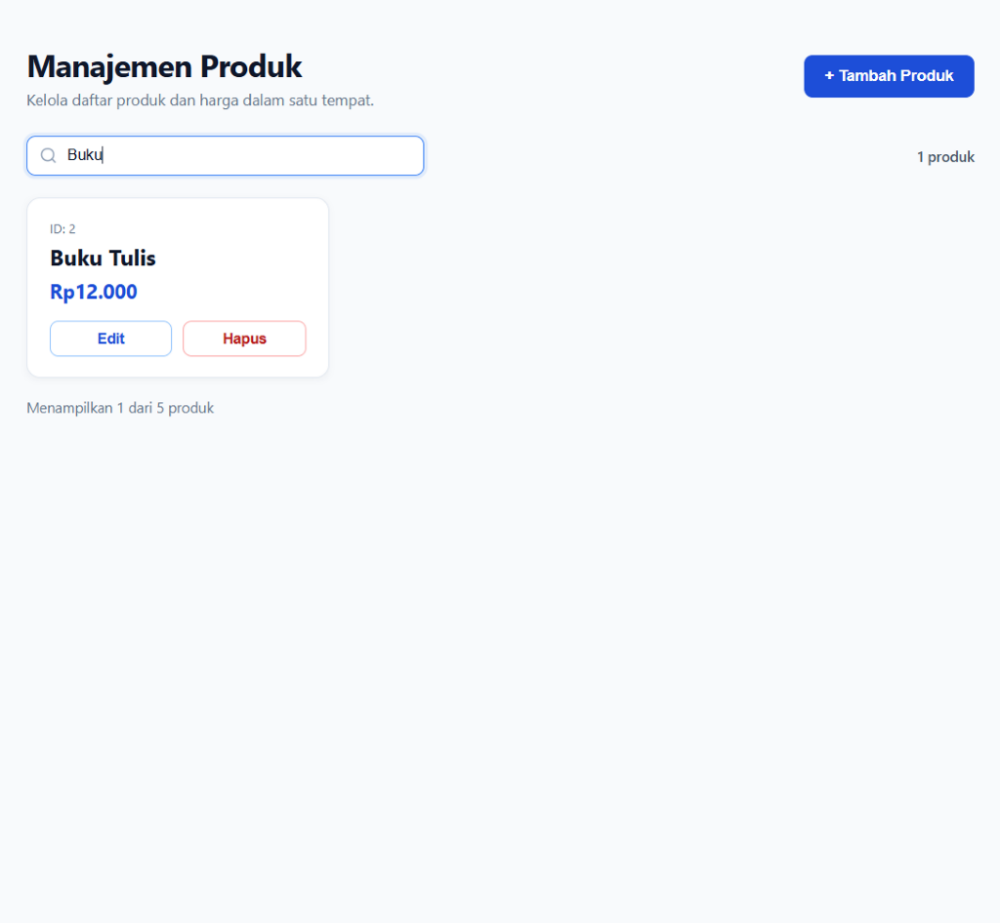
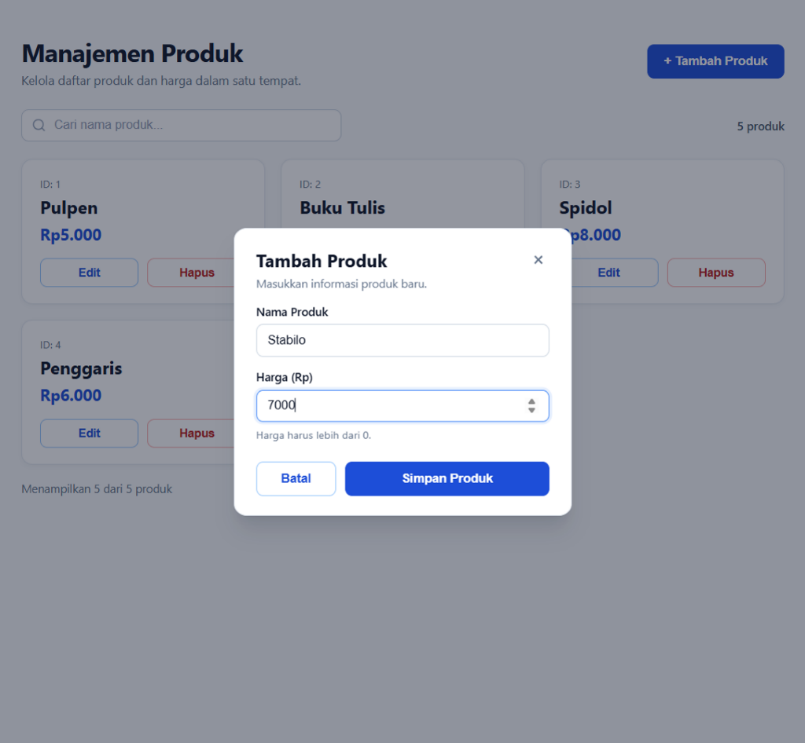
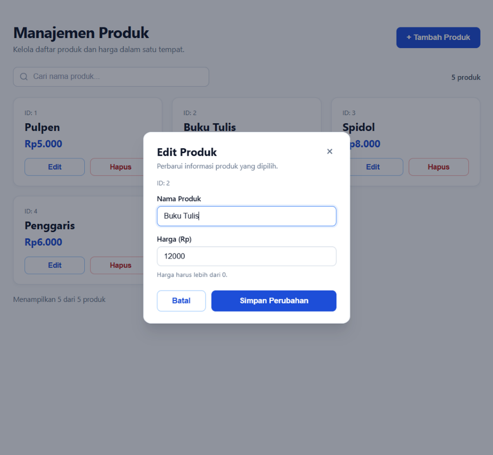
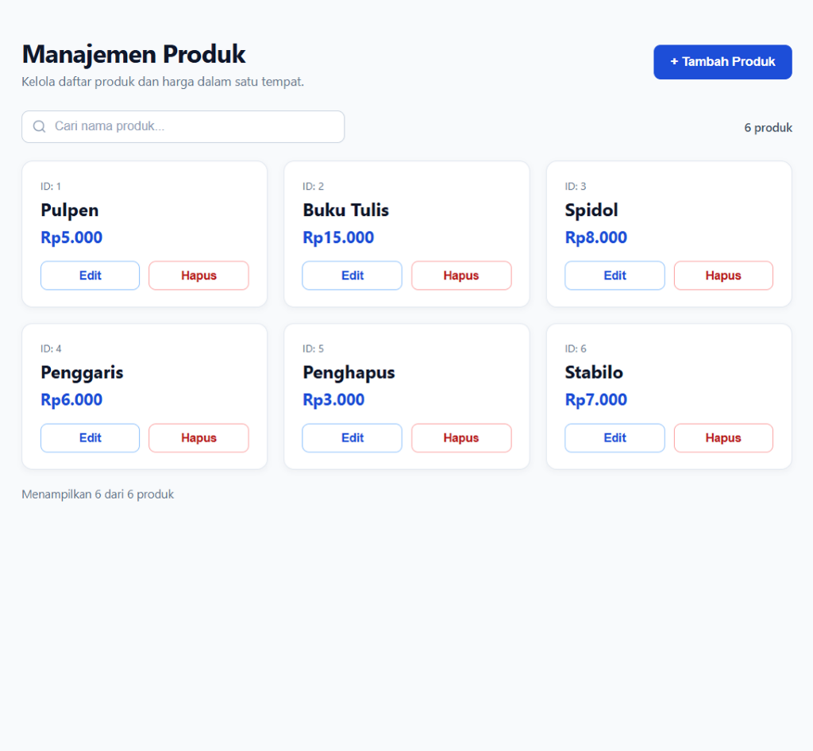
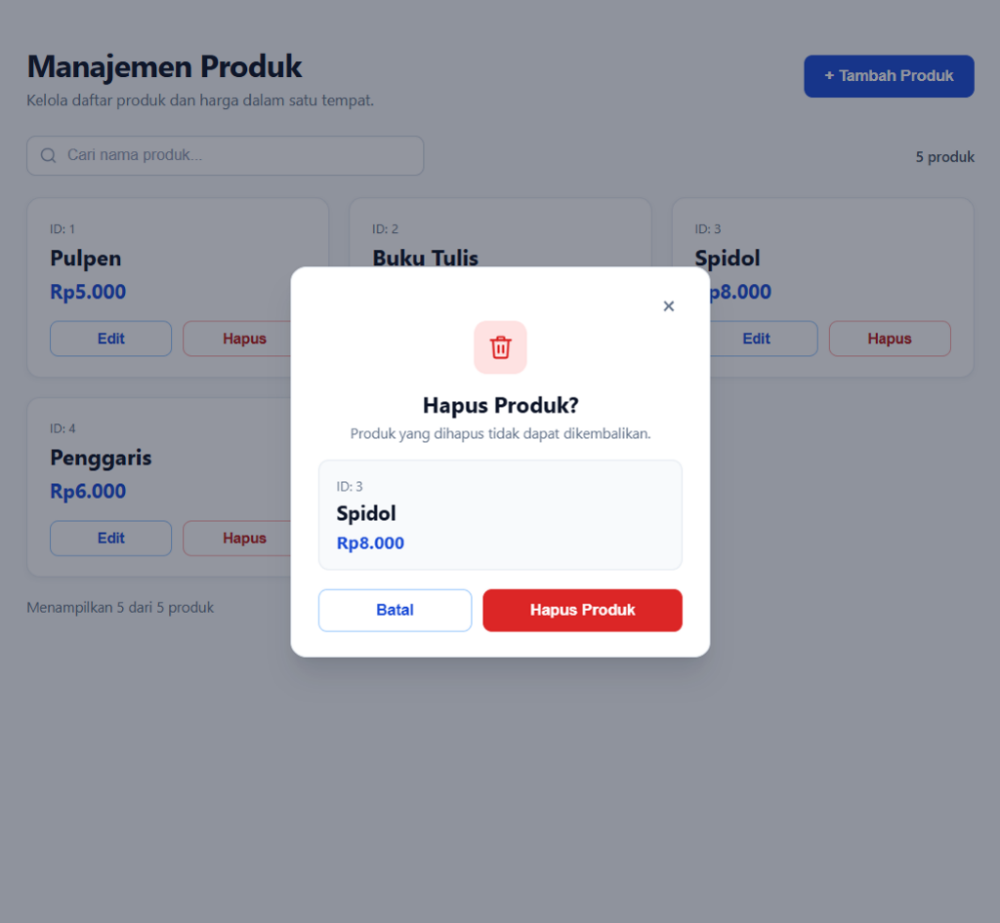
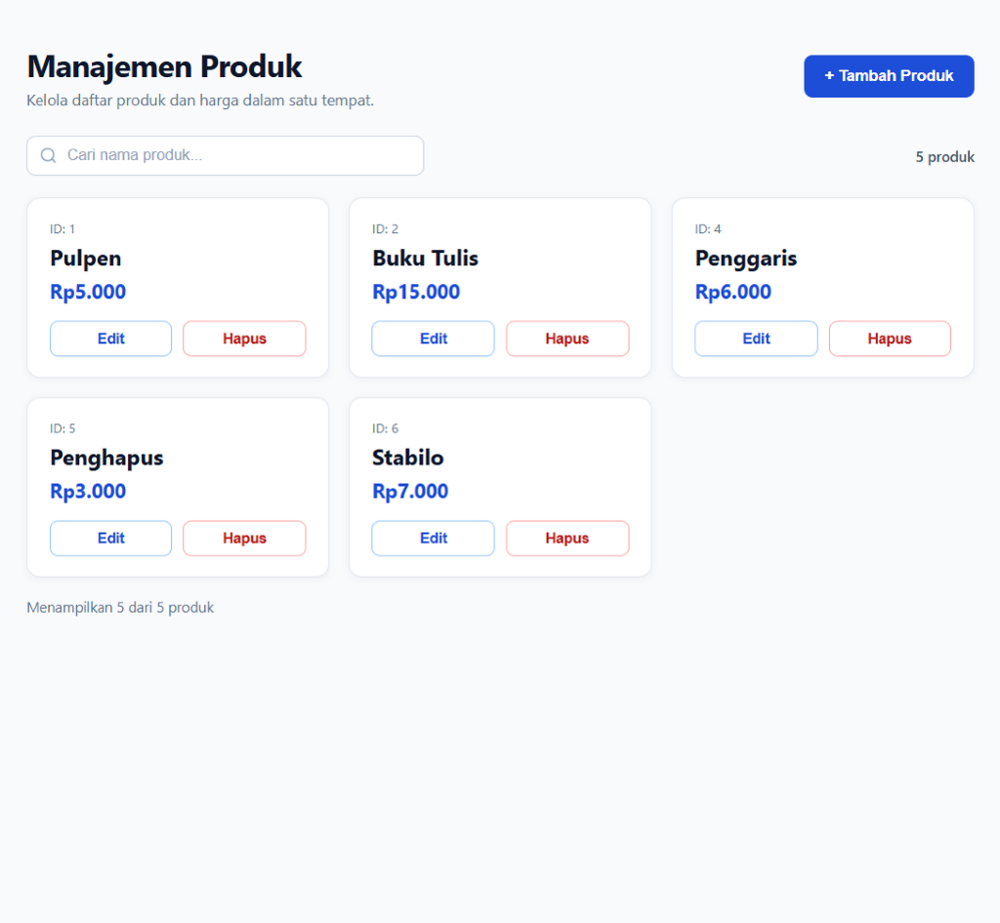

# Manajemen Produk - Tugas 3 Pemrograman Web (Fundamental React)

Aplikasi web satu halaman (*Single Page Application*) berbasis **React** untuk mengelola daftar produk dan harga dalam satu tempat.

## Fitur Utama
- **Daftar Produk (`ProductList` & `ProductCard`)**: Menampilkan kartu produk (ID, Nama Produk, dan Harga dalam format Rupiah) dari data *array of objects* yang dikirim melalui `props` antar komponen.
- **Pencarian Produk (`SearchBar`)**: Menyaring daftar produk secara *real-time* berdasarkan kata kunci nama produk serta menampilkan jumlah produk yang ditampilkan.
- **Pop-up Tambah Produk (`ProductFormModal`)**: Menambahkan produk baru dengan validasi nama produk dan harga harus lebih dari 0.
- **Pop-up Edit Produk (`ProductFormModal`)**: Memperbarui nama dan harga produk yang dipilih.
- **Pop-up Konfirmasi Hapus Produk (`DeleteConfirmModal`)**: Menampilkan dialog konfirmasi beserta ringkasan produk sebelum menghapus produk dari daftar.

## Cara Menjalankan Proyek

```bash
npm install
npm run dev
```

## Bukti Pengujian

| Skenario | Hasil yang Diharapkan | Hasil Aktual |
|---|---|---|
| Membuka halaman daftar produk | Daftar 5 produk awal ditampilkan beserta informasi ID, nama, dan harga | Sesuai |
| Mencari produk pada kolom pencarian | Daftar produk tersaring sesuai kata kunci nama produk | Sesuai |
| Menekan tombol `+ Tambah Produk` dan menyimpan produk baru | Pop-up Tambah Produk tampil dan produk baru ditambahkan ke daftar | Sesuai |
| Menekan tombol `Edit` pada salah satu produk dan menyimpan perubahan | Pop-up Edit Produk tampil dengan data terisi otomatis dan perubahan tersimpan | Sesuai |
| Menekan tombol `Hapus` pada salah satu produk dan mengonfirmasi penghapusan | Pop-up konfirmasi Hapus Produk tampil dan produk terhapus dari daftar | Sesuai |

### Screenshot Bukti Pengujian
1. **Halaman Utama Daftar Produk**
   
2. **Fitur Pencarian Produk**
   
3. **Form Pop-up Tambah Produk**
   
4. **Hasil Penambahan Produk Baru**
   
5. **Form Pop-up Edit Produk**
   
6. **Hasil Perubahan Data Produk**
   
7. **Pop-up Konfirmasi Hapus Produk**
   
8. **Hasil Penghapusan Produk**
   
